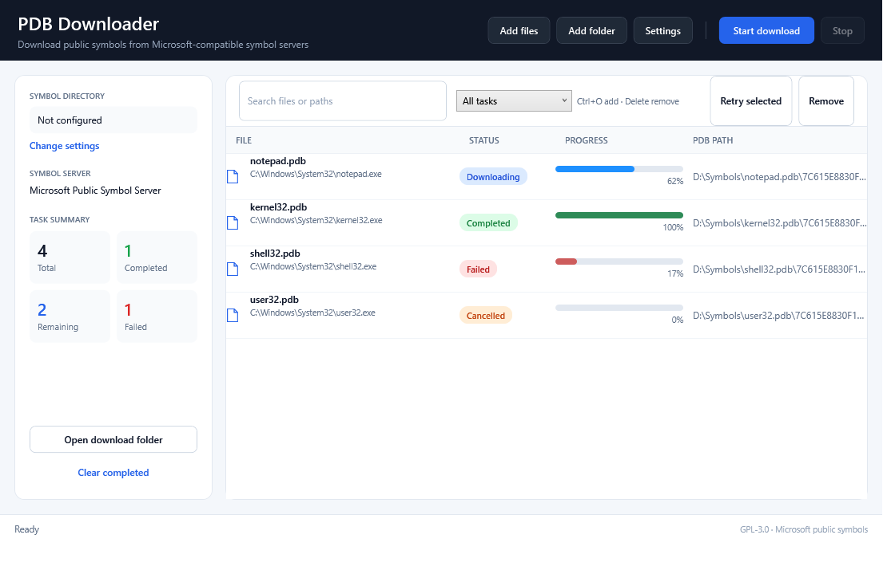
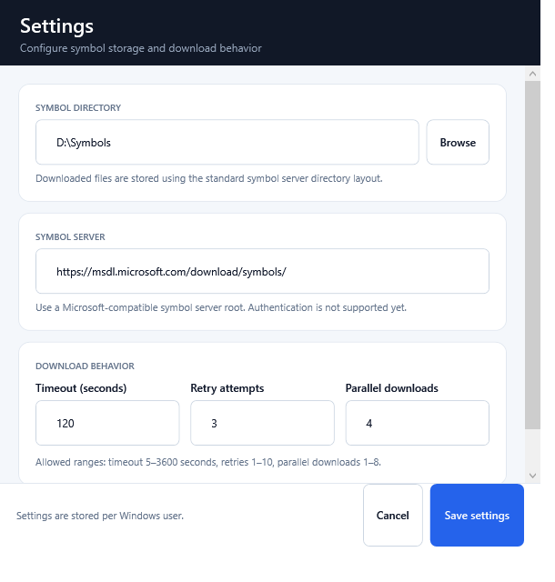

# PDB Downloader

**A fast, lightweight Windows GUI for downloading PDB debug symbols from Microsoft and compatible symbol servers.**

[Download the latest release](https://github.com/0cch/pdbdownloader/releases/latest) · [Report a bug](https://github.com/0cch/pdbdownloader/issues) · [Request a feature](https://github.com/0cch/pdbdownloader/issues)

[](https://github.com/0cch/pdbdownloader/releases/latest)
[](https://github.com/0cch/pdbdownloader/actions/workflows/release.yml)
[](LICENSE)

PDB Downloader is useful for WinDbg, Visual Studio, crash-dump analysis, reverse engineering, binary analysis, and any workflow that needs matching PDB files available locally.



## Why PDB Downloader?

- Drag in executable files or entire folders instead of resolving every PDB manually.
- Download from the Microsoft public symbol server or any Microsoft-compatible symbol server.
- Automatically use the compressed symbol file when available and fall back to the raw PDB.
- Keep the standard symbol-server directory layout so WinDbg and other debuggers can use the result directly.
- Inspect progress, failures, and retry individual tasks without restarting the whole batch.

## Features

- Supports `.exe`, `.dll`, `.sys`, `.ocx`, and `.cpl` files.
- Recursively scans dropped or selected folders and safely skips inaccessible directories and reparse points.
- Reads CodeView/PDB index information directly from PE files with `dbghelp.dll`.
- Supports compressed `.pd_` symbols and direct `.pdb` fallback.
- Uses temporary files, validates `expand.exe`, and atomically replaces the destination file.
- Configurable timeout, retry count, symbol server, and parallel download count.
- Search, status filtering, sortable columns, task summary, and per-task retry.
- Copy PDB paths and source URLs, reveal downloaded files in Explorer, and clear completed tasks.
- Taskbar progress, duplicate detection, existing-file reuse, and safe cancellation.
- Settings are stored per Windows user and legacy INI settings are migrated automatically.

## Quick Start

1. Download `pdbdownloader-*-win-x86.zip` from [Releases](https://github.com/0cch/pdbdownloader/releases/latest).
2. Extract the archive and run `pdbdownloader.exe`.
3. Choose a symbol directory.
4. Add files or drag a folder into the application.
5. Click **Start download** and open the symbol directory from the task list when finished.

Downloaded symbols use the standard layout:

```text
<symbol-root>\<pdb-name>\<GUID><AGE>\<pdb-name>
```

## Screenshots

### Main window


### Settings



## Configuration

Open **Settings** in the application or edit:

```text
%LocalAppData%\PdbDownloader\pdbdownloader.ini
```

| Setting | Description | Default |
| --- | --- | --- |
| `SymPath` | Local symbol download root | Required |
| `SymbolServer` | Microsoft-compatible symbol server root | `https://msdl.microsoft.com/download/symbols/` |
| `Timeout` | Per-attempt timeout in milliseconds | `120000` |
| `RetryCount` | Retry attempts for transient failures | `3` |
| `Concurrency` | Maximum parallel downloads | `2` |

Older `pdbdownloader.ini` files next to the executable are imported automatically.

## Requirements

- Windows 10 or later.
- .NET Framework 4.8.
- `dbghelp.dll` and `expand.exe`, included with Windows.

## Build

Open `pdbdownloader_v15.sln` in Visual Studio 2022, or run:

```powershell
msbuild .\pdbdownloader_v15.sln /t:Build /p:Configuration=Release /p:Platform=x86
```

Output:

```text
pdbdownloader\bin\Release\pdbdownloader.exe
```

## Release Process

Normal branch pushes do not publish releases. A GitHub Actions release starts only when a `v*` tag is pushed:

```powershell
git tag v1.2.3
git push origin v1.2.3
```

The workflow resolves the tag version, increments the assembly revision using `GITHUB_RUN_NUMBER`, builds `Release|x86`, creates a ZIP and SHA-256 checksum, and publishes them to GitHub Releases automatically.

## How It Works

1. `SymSrvGetFileIndexInfoW` reads the PDB name, GUID, and age from the input PE file.
2. The application builds the conventional symbol-server path.
3. It downloads the compressed symbol file first, then falls back to the raw PDB.
4. Compressed symbols are expanded and validated before replacing the destination file.

## Contributing

Bug reports, feature requests, and pull requests are welcome. Please include the Windows version, input file type, and a clear reproduction when reporting an issue.

If PDB Downloader saves you time, consider giving the repository a star so more debugging and reverse-engineering users can find it.

## License

GPL-3.0. See [LICENSE](LICENSE).